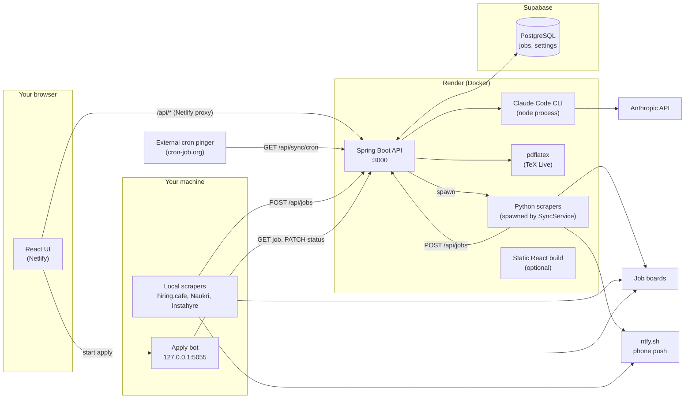
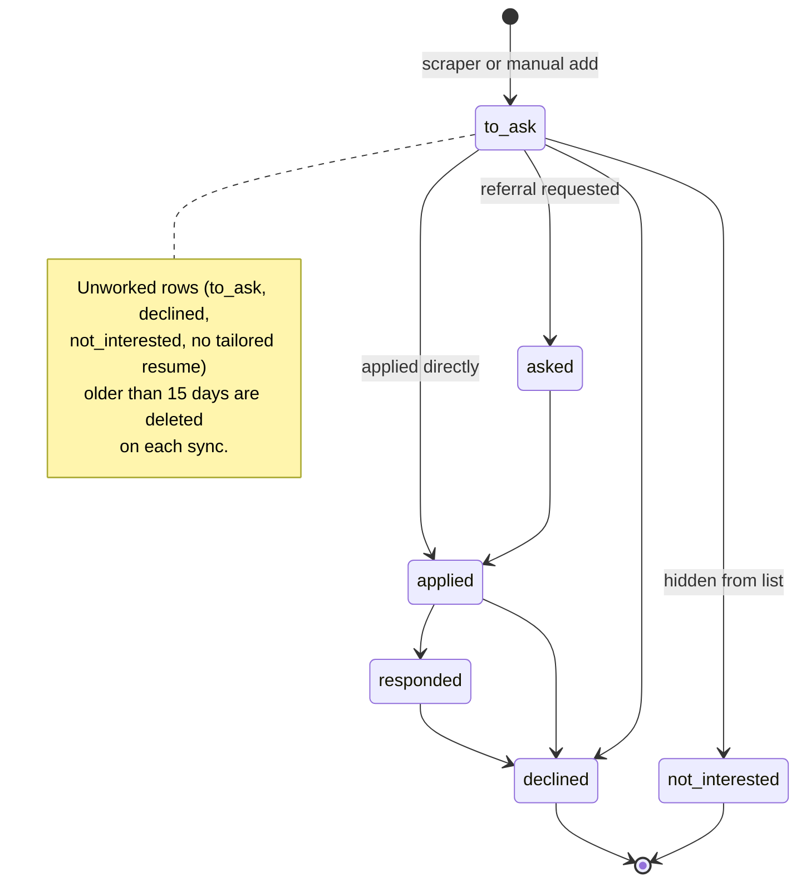
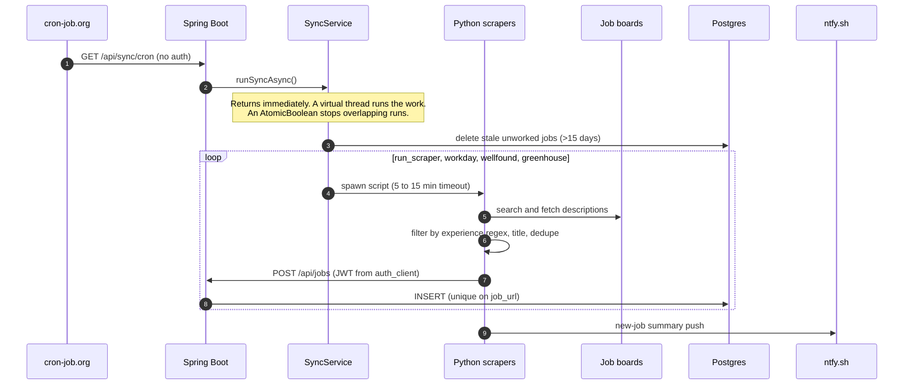
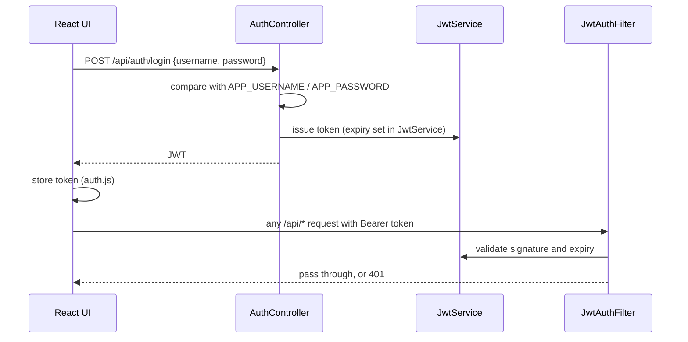
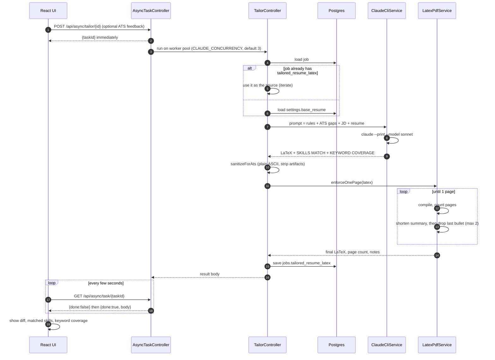
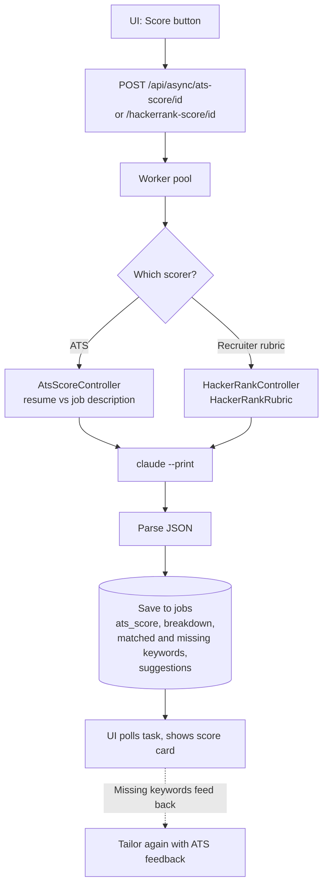
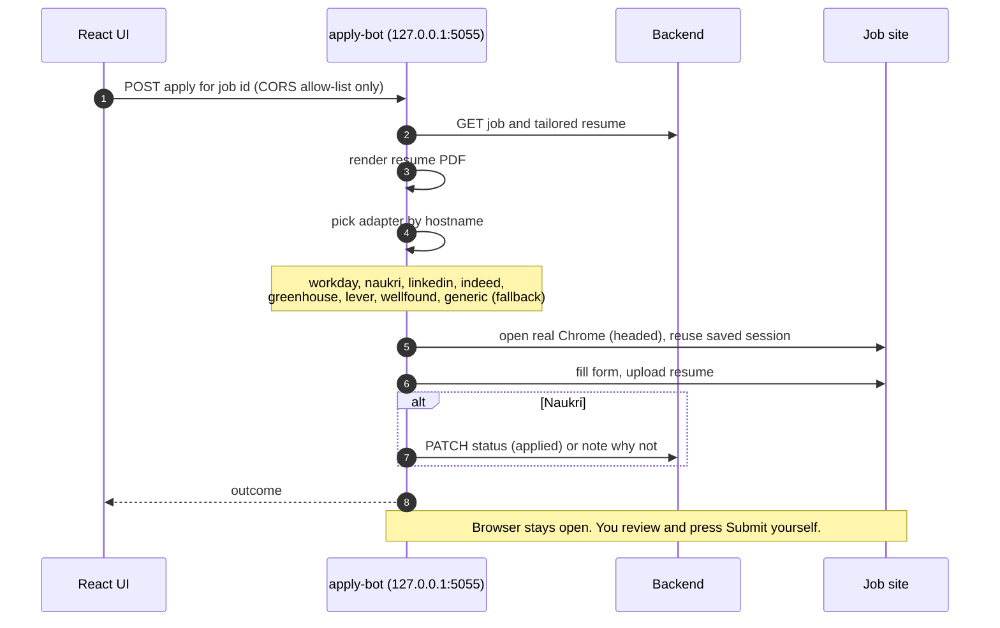
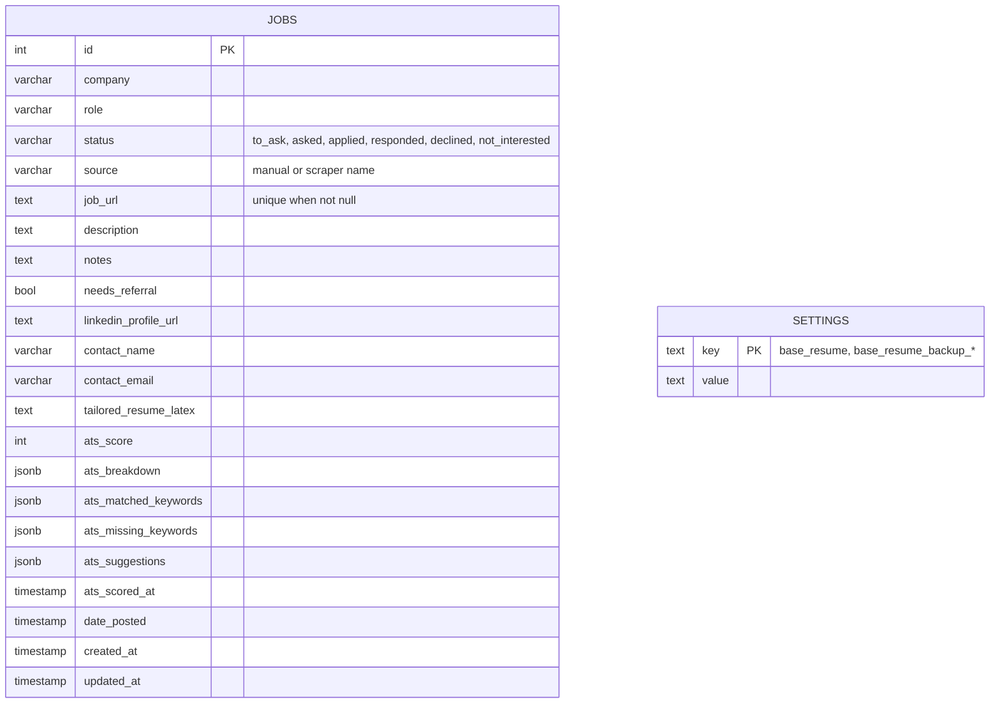
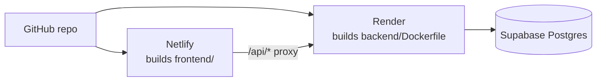

# Job Tracker

A personal job-hunting pipeline. It **finds** jobs from several boards, **tracks** them through an application pipeline, **tailors** your LaTeX resume to each job with Claude, **scores** the match (ATS and recruiter-style), and can **assist applying** through a local browser bot.

| Part | Folder | Tech | Runs where |
|---|---|---|---|
| Web UI | `frontend/` | React + Vite | Netlify (or `localhost:5173`) |
| API | `backend/` | Spring Boot 3, Java 21, JDBC | Render (Docker) or `localhost:3000` |
| Database | `schema.sql` | PostgreSQL on Supabase | Supabase |
| Job scrapers (server) | `scraper/` | Python (Indeed, LinkedIn, Workday, Wellfound, Greenhouse) | Spawned by the backend |
| Job scrapers (local) | `scraper/hiringcafe_search.py`, `naukri-scraper/`, `instahyre-scraper/` | Python, Playwright | Your machine (Windows scheduled tasks) |
| Apply bot | `apply-bot/` | Node + Playwright | Your machine (`127.0.0.1:5055`) |
| Legacy | `legacy-node/` | Old Node/Express version | Unused |

---

## 1. System architecture



**Key design points**

- The frontend only ever calls relative `/api/...`. `netlify.toml` proxies those to the Render backend, so there is no CORS to manage.
- All state lives in Postgres. The backend creates and migrates tables itself at startup (`DbInitializer`); `schema.sql` is documentation only.
- Claude is used through the **Claude Code CLI** (`claude --print`), not the HTTP SDK. The Docker image installs it and authenticates with `CLAUDE_CODE_OAUTH_TOKEN`.
- `pdflatex` is installed in the image, so PDF export and the one-page check run on the server.
- hiring.cafe is blocked by Cloudflare from Render, so it runs only on your machine. Naukri and Instahyre also run locally because they need a real browser session.

---

## 2. Job lifecycle

Every job row has a `status`. The pipeline strip in the UI counts and filters by it.



Status can be changed freely in the UI (`PATCH /api/jobs/{id}`); the diagram shows the normal direction of travel.

---

## 3. Flow: finding jobs (scraping)

Two paths feed the same `POST /api/jobs` endpoint.



**Local scrapers** (`naukri-scraper`, `instahyre-scraper`, `scraper/run_hiringcafe_local.ps1`) do the same thing from your PC on a Windows scheduled task (`run_task.bat`), because they need a logged-in browser or an IP that Cloudflare accepts. The Naukri scraper also keeps `seen` and `applied_jobs.json` state, and can auto-apply to recommended jobs.

Filtering lives in the scrapers (experience-range regexes, "senior/principal/lead" excludes, title keywords), so only relevant roles reach the database.

---

## 4. Flow: logging in



- `/healthz` and `/api/sync/cron` are public. Everything else needs the JWT.
- `JWT_SECRET` is optional. If unset, a fresh key is made on each boot and everyone must log in again after a redeploy.
- Scrapers authenticate the same way through `scraper/auth_client.py`.

---

## 5. Flow: tailoring a resume with Claude

This is the core feature. A tailor run can take a minute or more, so it is wrapped in an async task API to survive mobile screen-lock and proxy timeouts.



**What the prompt enforces** (`TailorController`): extract every JD keyword, place each one verbatim only where it is honestly true, never invent experience, keep the same LaTeX structure, keep the result to one page, rewrite the summary to 2 to 3 lines, and report gaps instead of faking them.

**Editing and preview**

- `POST /api/tailor/{id}/latex` saves hand edits to the tailored LaTeX.
- `POST /api/pdf` compiles any LaTeX to a PDF for the preview modal and download.
- `GET/POST /api/resume` reads and writes the **base resume**, stored in `settings` under key `base_resume`. On first boot it is seeded from `resume.tex`; after that the DB is the source of truth.

---

## 6. Flow: scoring

Both scorers use the same async pattern as tailoring.



- **ATS score**: stored on the job row (`ats_score`, `ats_breakdown`, `ats_matched_keywords`, `ats_missing_keywords`, `ats_suggestions`, `ats_scored_at`) so the card loads without re-scoring. `GET /api/ats-score/{id}` returns the saved result.
- **Recruiter rubric**: Open Source (35), Self Projects (30), Production Experience (25), Technical Skills (10), plus up to 20 bonus points.
- The loop **score, tailor with the gaps, re-score** is the intended workflow.

---

## 7. Flow: applying



Safety choices: the bot binds to `127.0.0.1` only, uses an explicit origin allow-list instead of `*`, runs a real headed Chrome with no stealth plugins, pauses for CAPTCHAs, and leaves the final Submit click to you. A headless variant (`remote-server.js`) exists for the hosted setup.

---

## 8. Data model



`settings` is a simple key/value table. The base resume lives under `base_resume`; manual backups use keys like `base_resume_backup_YYYYMMDD`.

---

## 9. API reference

| Method | Path | Purpose |
|---|---|---|
| POST | `/api/auth/login` | Get a JWT |
| GET | `/healthz` | Health check (public) |
| GET | `/api/jobs` | List jobs (filter by status) |
| POST | `/api/jobs` | Create a job (used by scrapers and the form) |
| PATCH | `/api/jobs/{id}` | Update status, notes, contact, etc. |
| DELETE | `/api/jobs/{id}` | Delete a job |
| GET / POST | `/api/resume` | Read or save the base resume |
| POST | `/api/tailor/{id}` | Tailor synchronously |
| POST | `/api/tailor/{id}/latex` | Save edited tailored LaTeX |
| GET / POST | `/api/ats-score/{id}` | Saved or fresh ATS score |
| POST | `/api/hackerrank-score/{id}` | Recruiter-rubric score |
| POST | `/api/async/tailor/{id}` | Start tailoring in the background |
| POST | `/api/async/ats-score/{id}` | Start ATS scoring in the background |
| POST | `/api/async/hackerrank-score/{id}` | Start rubric scoring in the background |
| GET | `/api/async/task/{taskId}` | Poll a background task (kept 30 min) |
| POST | `/api/pdf` | Compile LaTeX to PDF |
| POST | `/api/sync` | Run all server scrapers and wait |
| GET | `/api/sync/cron` | Start scrapers in the background (public, for cron) |

---

## 10. Running locally

**Prerequisites:** Java 21, Maven, Node 20+, PostgreSQL, Python 3.10+, a TeX distribution with `pdflatex` (MiKTeX or TeX Live, including the Lato font), and the Claude Code CLI logged in.

```bash
# 1. Database (local Postgres; defaults: db job_tracker, user postgres, password admin)
createdb job_tracker

# 2. Backend  ->  http://localhost:3000
cd backend
mvn spring-boot:run

# 3. Frontend  ->  http://localhost:5173
cd frontend
npm install
npm run dev

# 4. Scrapers (optional)
cd scraper
pip install -r requirements.txt
python run_scraper.py

# 5. Apply bot (optional)
cd apply-bot
npm install
cp .env.example .env
node server.js
```

Tables are created automatically on first backend start. Default login is `admin` / `admin` unless `APP_USERNAME` and `APP_PASSWORD` are set.

To compile the resume by hand:

```bash
pdflatex resume.tex
```

## 11. Configuration

Backend environment variables (see `render.yaml`):

| Variable | Purpose |
|---|---|
| `APP_USERNAME`, `APP_PASSWORD` | UI login |
| `JWT_SECRET` | Optional, keeps sessions valid across redeploys |
| `DB_HOST`, `DB_PORT`, `DB_NAME`, `DB_USER`, `DB_PASSWORD`, `DB_SSLMODE` | Postgres. On Supabase use the **pooler** host, and `postgres.<project-ref>` as the user |
| `FRONTEND_ORIGIN` | Your Netlify URL |
| `CLAUDE_CODE_OAUTH_TOKEN` | From `claude setup-token`; lets the CLI run on the server |
| `CLAUDE_CONCURRENCY` | Parallel Claude runs (default 3) |
| `CLAUDE_EFFORT` | Claude effort level (default `medium`) |
| `SYNC_TIMEOUT_*_SECONDS` | Per-scraper timeouts |

Scrapers read `notify_config.json` (`ntfy_topic`) for push notifications. Local scrapers read their own `.env` / `local.env` (see the `*.example` files).

## 12. Deployment



- **Netlify** builds `frontend/` and only rebuilds when `frontend/` or `netlify.toml` changed.
- **Render** builds the multi-stage `backend/Dockerfile`: Maven build, then a Java 21 runtime with TeX Live, Node, the Claude Code CLI, Python, and the scraper folder. It runs as an unprivileged user, which the Claude CLI requires.
- Health check: `/healthz`.

## 13. Security notes

- The Supabase tables currently have **Row Level Security disabled**, so anyone with the anon key can read or write them (this includes your resume in `settings`). The backend connects with the database password, not the anon key, so enabling RLS with no policies would not break the app. Check before enabling.
- Never commit `.env` files, the Supabase DB password, or `CLAUDE_CODE_OAUTH_TOKEN`.
- `/api/sync/cron` is intentionally unauthenticated. It only starts a scrape and cannot return data, but anyone who finds the URL can trigger runs.
